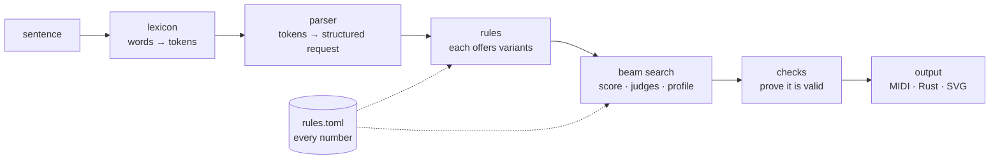

# HotMotor

**Feels like prompting an AI. Behaves like a compiler.**

HotMotor is the engine design behind three of my projects:

- [FeelRight](https://github.com/Joosehot/FeelRight) turns chords and mood words into melodies.
- [Senne](https://github.com/Joosehot/Senne) turns plain English into Rust.
- [Aras](https://github.com/Joosehot/Aras) turns a sentence into a sewing pattern and product sheet.

The three are different domains built on the same machine. You type a sentence and get a finished result back, like with a generative model, but no neural network runs at generation time. The same sentence always gives byte-identical output, every decision can be traced to the words that asked for it, and a request that can't be met gets an explanation instead of a plausible-looking wrong answer.

This post explains how it works and how to build one.

---

## The idea

Many domains already have their rules written down:

| domain | the rules people already use |
|---|---|
| music | voice leading, chord tones on strong beats, tension and release, phrase shape |
| code | error handling idioms, no panics, consistent style, reuse over repetition |
| clothing | matching seams are equal, the sleeve cap fits the armhole, the neckline passes the head, stripes match at the seams |

A neural generator learns rough statistics from examples and guesses. That's why AI images get fingers wrong and why a melody generator drifts off key. When the rules are known, you can apply them directly, so there is nothing to guess.

The hard part is making that usable. People don't want to fill in a form with 40 fields. They want to write *"make an oversized black hoodie with white sleeves and rib cuffs"*. HotMotor is the bridge: a small, closed language front end and a search over hand-written rules.

## The pipeline



Every HotMotor engine has the same six parts.

### 1. Lexicon: a closed vocabulary

A hand-written table maps words and phrases to meaning. `"t-shirt"`, `"tee"` and `"t shirt"` all become `Garment(Tshirt)`. `"longer"` becomes the comparative of *lengthen*. `"2 inches"` becomes 50.8 mm. `"dark green"` becomes a shade of a palette colour.

It is **closed**: a word the engine doesn't know is an error, with a suggestion.

```
$ aras "make a hodie"
error: unknown word "hodie"
  hint: did you mean "hoodie"? (--vocabulary lists every word, --lenient skips unknown ones)
```

It never guesses, and that is the single most important choice in the whole design. `--lenient` exists for when you really want unknown words skipped, and you have to ask for it.

### 2. Parser: a sentence becomes a request

A small grammar turns tokens into a structured request:

- a chord progression and mood in FeelRight
- a clause tree of verbs, values, loops and error handlers in Senne
- a garment spec in Aras (garment, size, fit, features, edits with amounts, colours, prints)

The grammar is deliberately small and explicit:

- Clauses split on "and", commas and "then".
- "with …" lists features.
- An amount belongs to its own clause.
- A clause without a verb repeats the previous verb ("lengthen the sleeves *and the body* by 2 inches").
- A number without a unit is an error ("2 what?").

Every value the parser keeps remembers the **words that produced it**, so the output can say why it looks the way it does.

### 3. Rules: one decision, one file

The domain knowledge lives in rules, one per file. A rule does three things:

1. says whether this request needs its decision, and which words asked for it
2. offers **variants**, the different valid ways to do it
3. carries out the chosen variant

For example:

| engine | rule | variants |
|---|---|---|
| FeelRight | cadence | authentic, half, deceptive… |
| Senne | read a file | whole string / buffered lines × propagate `?` / `expect` / handle |
| Aras | hood | two-piece / three-piece (and lined / single) |
| Aras | sleeve length | continue the taper / keep the hem width |

Rules contain **no numbers**. Every weight, every threshold and every measurement is read from `rules.toml`. The rule says "the sleeve cap must be longer than the armhole by the fabric's cap ease"; the TOML says the ease is 0–10 mm for jersey and 10–30 mm for shirting. That split keeps the code about *logic* and makes the *taste* editable without touching code.

Each rule has one test where it applies and one where it doesn't.

### 4. Scoring: a profile, not a single objective

Every variant is scored on a few axes that describe a real tradeoff in the domain:

| engine | axes | words that shift them |
|---|---|---|
| FeelRight | tension curve over the phrase | style and mood words |
| Senne | safety · brevity · performance | "safely", "simply", "quickly" |
| Aras | finish · simplicity · economy | "neatly", "simply", "cheaply" |

A variant's score is `weight × (its axes · the request's profile)`. The profile starts at defaults in `rules.toml`, and the sentence's modifiers move it. *"Simply make a shirt"* shifts the profile toward simplicity, so the one-piece collar beats the collar with a stand. The words say which tradeoff to spend.

### 5. Beam search with judges

Choosing each rule's best variant greedily isn't enough, because choices interact:

- Rib cuffs look right when the hem is ribbed too, and odd when it isn't.
- In Senne, using `?` once makes the whole function return `Result`, so the second `?` is cheaper than the first.
- In Aras, the first rib part means buying a second fabric; every one after that is free.

These cross-cutting preferences are **judges**. They look at the whole set of choices so far and add bonuses or penalties. The search goes rule by rule, expanding each partial solution with every variant. It ranks by local score plus judges and keeps the best *N* (the beam width, also in `rules.toml`). Ties break on a fixed order, so the result is deterministic.

### 6. Checks: prove it before you output it

The finalists are built for real and then **checked against hard rules of the domain**:

- **Senne** compiles every generated file with `rustc -D warnings`.
- **Aras** drafts the pattern and verifies it:
  - shoulder, side, underarm, inseam and outseam seams are equal lengths
  - the sleeve cap is 0–10 mm longer than the armhole for knits
  - the head goes through the stretched neckband and the hand through the cuff
  - no outline crosses itself
- **FeelRight** enforces its unbreakable theory rules.

A candidate that fails is dropped, and the next one is tried. If the beam runs out, every combination is tried. If *nothing* passes, the engine says why and outputs nothing:

```
$ aras "make a t-shirt and narrow the collar by 12 inches"
error: no way to build this t-shirt passes the construction checks
  hint: head goes through the neckline: opening 37.6 cm stretches to 52.7 cm, head is 57.5 cm
```

This is the difference from a generative model. The engine won't give you a confident, broken answer.

---

## What you get from building it this way

- **Determinism.** The same sentence and the same `rules.toml` give byte-identical output. You can keep golden files of the output under version control and diff them, like a compiler test suite.
- **Explanations for free.** `--explain` prints the tokens, the parsed request, every candidate with its score, the judges' notes, the finalists and every check. In the output, every piece says which rule made it and which words asked for it.
- **Taste you can edit.** All numbers live in `rules.toml`. Change a weight and the engine's taste changes, with no retraining and no code change. Point `--rules` at your own file.
- **Honest failure.** Unknown words, unused values and impossible requests are errors with hints.
- **Tiny and fast.** No model weights and no GPU. A few thousand lines of Rust that finish in milliseconds.

And what it costs:

- **Coverage is hand-built.** The engine only knows what someone wrote a rule for. Senne's v0 knows 19 code patterns; Aras knows five garment families. Outside that it refuses instead of improvising.
- **The language is small.** It feels natural inside its vocabulary and is strict outside it, much like a programming language that happens to read like English.
- **Someone has to know the domain.** The rules are only as good as the music theory, the Rust idioms or the pattern drafting behind them.

## Where AI still fits

HotMotor keeps models **out of the generation loop**, not out of the project. A language model is useful around it:

- drafting new rules
- suggesting vocabulary
- reading a failure and diagnosing which rule is missing
- turning a vague request into a sentence the engine understands

What it doesn't do is produce the output. The loop that makes the result stays rules plus search, so the result stays reproducible and explainable.

## Building your own HotMotor

1. **Pick a domain with written-down rules** and a way to *check* a result: a compiler, a construction rule, a theory. If you can't check it, you can't trust it.
2. **Write the lexicon first**, small and closed. Map synonyms to one token. Make unknown words errors with a closest-match hint.
3. **Define the request** the parser produces: what was asked, plus the words that asked for it.
4. **Write one rule per decision**, each with its variants, one file each, with a passing and a failing test.
5. **Choose two or three axes** that describe the real tradeoff in your domain, and the modifier words that shift them.
6. **Add judges** for the interactions between rules.
7. **Beam search**, deterministic tie-breaking, all numbers in a TOML file, validated at load so a typo fails immediately.
8. **Check before output**, and when nothing passes, say why.
9. **Golden tests**: example sentences whose output is committed. Run each several times to prove determinism, and bless intended changes with one environment variable.

## The three engines, side by side

| | FeelRight | Senne | Aras |
|---|---|---|---|
| input | chords, mood, style | plain-English description of a program | plain-English description of a garment |
| output | MIDI melody | Rust source | sewing pattern, cutting layout, product sheet (SVG) |
| vocabulary | `theory.rs` | `lexicon.rs` | `lexicon.rs` |
| rules | 37 music rules | 19 code patterns | 18 construction rules + design rules |
| judges | breakable theory rules | no panics, consistent errors, helper reuse, Result signature | consistent finish, rib as second fabric, fabric use |
| profile | tension curve | safety · brevity · performance | finish · simplicity · economy |
| proof | theory checks, by ear | every output compiles with `rustc -D warnings` | every seam, clearance and outline checked |

An Aras example: *"make an oversized black hoodie with white sleeves, a grey hood and rib cuffs"*. The engine drafts the pieces from body measurements, solves the sleeve cap and the hood's neck edge, and checks all 12 construction rules. It then splits the fabric per colour and draws the flats from the real pieces:


---

*HotMotor is a design, not a library. There's no crate to depend on. Each engine is its own small program that follows the same shape. Take the idea and build one for your own domain.*

## License

MIT, see [LICENSE](LICENSE). © 2026 Joose Hotari.
